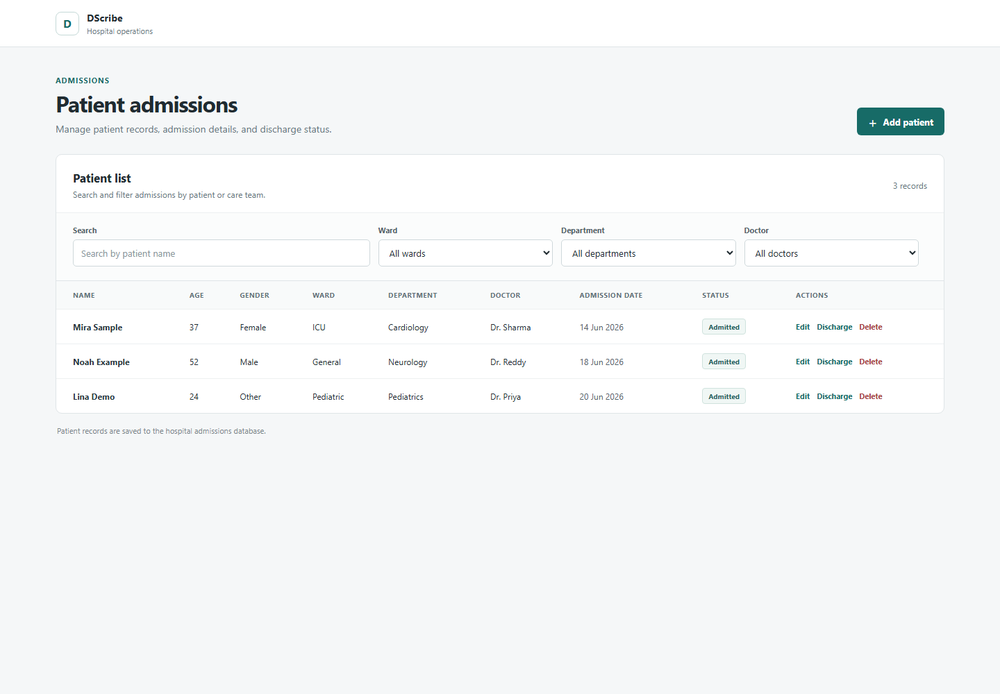
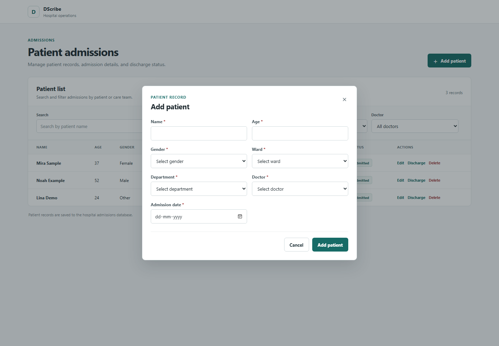
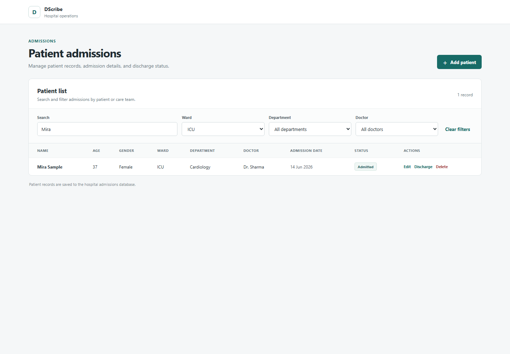
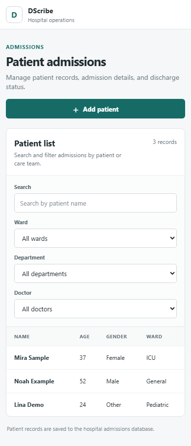
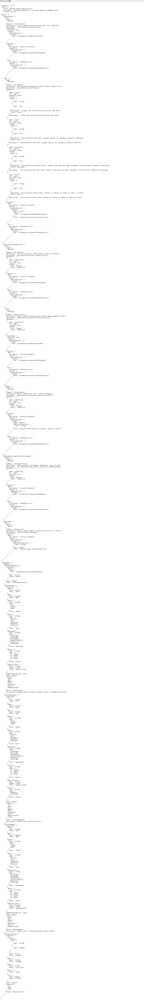

# Patient Admission Management App

## Overview

A small patient-admission app for recording and managing hospital admissions. The frontend is a React single-page app, the API is built with FastAPI, and patient records are stored in SQLite.

## Features

- Add and view patient records
- Search by patient name
- Filter by ward, department, and doctor
- Edit and delete patient records (deletion requires confirmation)
- Mark patients as discharged
- Frontend and backend validation
- Responsive desktop, tablet, and mobile layout

## Tech Stack

- Frontend: React, Vite
- Backend: Python, FastAPI, Uvicorn
- Database: SQLite
- ORM: SQLAlchemy

## Architecture

```text
React frontend
      ↓ HTTP/JSON
FastAPI backend
      ↓ SQLAlchemy
SQLite database
```

## Local Setup

### Backend (PowerShell)

```powershell
cd backend
python -m venv .venv
.\.venv\Scripts\Activate.ps1
python -m pip install -r requirements.txt
python -m uvicorn app.main:app --reload
```

The backend runs at `http://127.0.0.1:8000`. The API documentation is at `http://127.0.0.1:8000/docs`.

The SQLite database defaults to `backend/app/database.db`. To use another path, set `DATABASE_PATH` in the backend process environment before starting Uvicorn.

### Frontend

In a second terminal:

```powershell
cd frontend
npm install
npm run dev
```

Vite prints the local frontend URL, normally `http://localhost:5173`. The frontend defaults to the API at `http://127.0.0.1:8000`. To override it, copy `frontend/.env.example` to `frontend/.env.local`, edit `VITE_API_BASE_URL`, and restart Vite.

## API

| Method | Endpoint | Purpose |
| --- | --- | --- |
| GET | `/api/health` | Health check |
| GET | `/api/patients` | List patients; supports search and filters |
| POST | `/api/patients` | Create a patient |
| GET | `/api/patients/{patient_id}` | Get one patient |
| PUT | `/api/patients/{patient_id}` | Update editable patient details |
| PATCH | `/api/patients/{patient_id}/discharge` | Mark a patient as discharged |
| DELETE | `/api/patients/{patient_id}` | Delete a patient |

`GET /api/patients` accepts these optional query parameters. When more than one is provided, the API applies all supplied filters together:

- `search`: case-insensitive partial match against the patient name
- `ward`: exact ward choice
- `department`: exact department choice
- `doctor`: exact doctor choice

For example: `/api/patients?search=alex&ward=ICU&department=Cardiology`.

While the backend is running locally, interactive Swagger UI is available at `http://127.0.0.1:8000/docs`, and the OpenAPI schema is available at `http://127.0.0.1:8000/openapi.json`.

## Validation

The frontend requires all patient fields, accepts names containing letters and spaces, restricts age to an integer from 0 through 120, and prevents future admission dates. The API independently validates the same fields and allowed select values; invalid requests return HTTP 422 with a validation detail.

## Testing and Verification

The results below are from the previously completed local integration audit. They are recorded here for reference and were not rerun during this documentation and screenshot update.

| Area | Previously completed result |
| --- | --- |
| Patient CRUD | Passed: create, list, retrieve, update, delete, and discharge flows were verified locally. |
| Search and filters | Passed: name search and ward, department, and doctor filters were verified, including combined filters. |
| Frontend validation | Passed: required fields, name format, age range, and admission-date rules were checked in the form. |
| Backend validation | Passed: invalid API input was independently rejected with validation errors. |
| SQLite persistence | Passed: patient data remained available after a local backend restart. |
| Error handling | Passed: API and connection errors were surfaced to the user through the application UI. |
| CORS | Passed: local frontend/API cross-origin behavior was checked. |
| Swagger/OpenAPI | Passed: the local API documentation and OpenAPI schema were checked. |
| Responsive layouts | Passed: desktop, tablet, and mobile layouts were checked. |
| Production build | Passed: the frontend production build completed successfully. |

## Screenshots

These screenshots were captured from the local application using fictional demonstration records. The OpenAPI image shows the schema returned by FastAPI at `/openapi.json`.

### Patient list



### Add patient form



### Search and filters



### Mobile layout



### OpenAPI schema



## Deployment Status

The application is not deployed. There are currently no live frontend or backend URLs. The local URLs in the setup and API sections are for local development only.
